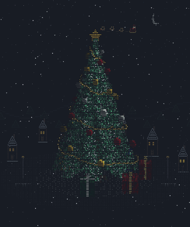
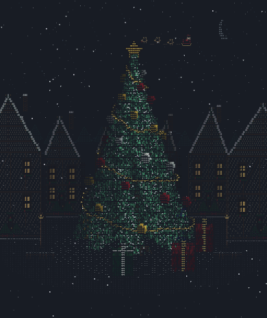

# Village v2 / responsive chat review

Baseline: `ccd910183fccaab1f4ef4e969278edb34e210d4e`.
Local implementation only; production deployment requires approval.

## Scope

- `village.js`: six cached timber-framed houses, asymmetric snowy roofs,
  garlands, wreaths, warm split windows, chimneys, lamps and miniature firs.
  Near buildings frame the sides; smaller darker buildings sit behind the tree.
  Static geometry is rebuilt only when dimensions or detail tier change.
  Mobile uses fewer infill characters, decorative lights and smoke particles.
- `scene.js`: environment-only glow marker, clipped to its own character cell.
  Existing tree writes replace this marker. Tree animation, projection, shading,
  opacity, snow animation and original bloom calculations are unchanged.
- `styles.css`, `chat-layout.js`, `index.html`: replace the mobile panel's 320px
  minimum and incomplete viewport calculation with available visual viewport
  height, safe-area margins and a non-shrinking composer. Keyboard resize events
  are coalesced. Scroll only when the focused input would be obscured. Pinch zoom
  remains enabled. Desktop layout and the original canvas sizing rules remain.
- `server.py`: only add the new UI script to the existing asset allowlist.
  No storage, credentials, API behavior or schema changes.

`geometry.js`, `christmas_tree_3d.py`, `santa.js`, music and chat networking are
unchanged. No canvas filter or global brightness/saturation adjustment is used.
The original canvas clear color is retained so translucent tree rendering does
not acquire a different backdrop in the isolated comparison.

## Automated verification

- Existing Node scene/audio/chat/admin tests pass.
- Python HTTP suite: 6 tests pass, including the new static script route.
- Mobile viewport simulations: 320x568, 390x844, 430x932 and 760x390;
  desktop mode checked at 1280x800. Input stays above the simulated keyboard,
  safe-area allowance is subtracted, repeated resize notifications coalesce,
  blur restores panel height, pinch zoom is not overridden.
- Native Canvas raster tests: 320x381, 390x464, 756x900 at times
  0, 2, 4, 7, 9.6, 10.7, 12, 14.5, 20.1 and 42 seconds.
  Isolated tree+snow RGBA pixels are byte-identical to the baseline at every
  sample. Glyph/RGB/depth/opacity/bloom buffers also match exactly.
- With scenery enabled, 87,330 / 86,994 / 87,083 tree cells respectively match
  the baseline across those samples. Cache builds once per unchanged viewport.
- Pause/resume and hidden-tab frame cancellation pass.
- Protected source files match the baseline after normalizing Git CRLF/LF.

## Performance measurements

Native Canvas in a Node VM, 30 measured frames after five warm-up frames.
These values are test-harness timings, NOT Chrome or physical-phone FPS.

| Canvas | Baseline median / p95 | v2 median / p95 |
| --- | --- | --- |
| 320x381 | 60.37 / 99.71 ms | 65.24 / 106.85 ms |
| 390x464 | 55.36 / 94.44 ms | 65.83 / 106.53 ms |
| 756x900 | 55.70 / 95.77 ms | 66.62 / 108.82 ms |

The frame scheduler remains capped at 30 FPS. This harness exceeds the 33.3ms
budget even on the baseline, so it does not establish achieved 30 FPS on a real
device. Added median cost is 4.87-10.92ms in this harness. Browser profiling and
long-duration real-device memory testing remain required before calling the
performance goal verified.

## Captured frames

These are native Canvas renders, not browser screenshots.

| Before | After |
| --- | --- |
|  |  |

Full-size frames: [baseline](before-756.png), [v2](after-756.png).

## Reproduce

```text
python -m unittest -v test_server.py
node test_scene.cjs
node test_ui.cjs
node test_admin.cjs
node test_chat_layout.cjs
```

For pixel comparison, install `@napi-rs/canvas` in a separate test directory,
set `CANVAS_MODULE` to that package's absolute path, then run
`node test_visual.cjs`. Optional `VISUAL_OUTPUT` writes frames to an existing
directory. This dependency is not installed or loaded by the production app.

## Remaining device verification

Browser-control tools were unavailable. Native Canvas verifies raster output,
but it is not a substitute for Chrome/Safari CSS layout and real iOS keyboards.
Before deployment, inspect desktop Chrome, iPhone Safari, 320px width, portrait
and landscape, keyboard open/closed, address-bar expansion, large text and zoom.
Confirm composer visibility, readable messages, no horizontal scroll and music
controls. Production data has not been changed and nothing has been pushed.
